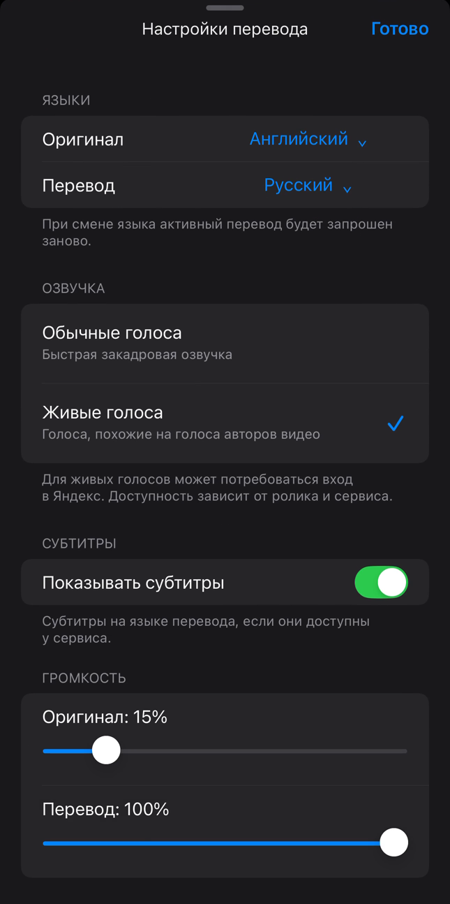

# YouTube VOT for iOS

Экспериментальное нативное дополнение: закадровый перевод и субтитры в плеере YouTube на iPhone. Написано на Objective-C и C. Неофициальный независимый проект; не связан с Google, YouTube, Яндексом или авторами uYouEnhanced.

Репозиторий содержит исходники дополнения, тесты и инструменты локальной сборки. Приложение YouTube, IPA, сертификаты и профили подписи не распространяются.



## Возможности

- Отдельная кнопка перевода и панель настроек.
- Обычные и живые голоса, когда сервис предоставляет их для выбранного видео и аккаунта.
- Выбор исходного языка; перевод на русский, английский или казахский, в пределах возможностей сервиса.
- Независимая громкость оригинала и перевода.
- Синхронизация при паузе, перемотке и изменении скорости.
- Субтитры, если доступны, и экспорт готовой аудиодорожки через меню iOS.
- Индикация подготовки и буферизации до начала воспроизведения озвучки.

## Совместимость и ограничения

Проверялось вручную с YouTube 20.44.2 / uYouEnhanced 3.0.4 на физическом iPhone. Библиотека собирается для arm64, iOS 15+. Работа на других версиях приложения или устройствах не подтверждена. Интеграция использует внутренние методы приложения, которые могут измениться.

Поддерживаются обычные ролики до четырёх часов. Вывод перевода на удалённое устройство не реализован. Полный регресс фонового воспроизведения и Picture in Picture не проведён. Доступность живых голосов, языков и перевода зависит от Яндекса; ошибки или изменения неофициального API могут нарушить работу.

## Сборка и тесты

Требуются macOS, Xcode с iOS SDK и Python 3.9+.

```sh
bash scripts/build.sh
```

Скрипт выполняет автономные тесты протокола, HTTP-клиента с фиктивным транспортом, синхронизации, состояния воспроизведения, субтитров, защиты от ошибки запуска и упаковщика. Затем собирает `build/YouTubeVOT.dylib` с локальной ad hoc подписью. Сеть, IPA и сертификат разработчика для этих проверок не нужны. Успешные тесты не заменяют проверку воспроизведения на устройстве.

## Локальная упаковка

Для интеграции нужны совместимое приложение, право на его модификацию и собственные действительные средства подписи. Этот проект не предоставляет приложение, способы его получения, снятия DRM или обхода ограничений аккаунта. Скрипт отказывается обрабатывать зашифрованный исполняемый файл.

```sh
python3 scripts/package_ipa.py --help
```

Идентификатор приложения передаётся явно через `--bundle-id` и должен соответствовать вашему provisioning profile. Параметры `--profile`, `--identity` и при необходимости `--keychain` задают ваши средства подписи. Для отдельной установки идентификатор должен отличаться от идентификатора входного приложения. Входной архив сохраняется; результат указывается через `--output`.

Упаковщик удаляет вложенные расширения приложения, для которых потребовались бы отдельные профили и capabilities. Произвольные entitlements исходного приложения не переносятся. Совместимость входного приложения с такой переподписью не гарантируется. Не публикуйте полученные архивы вместе с этим проектом.

## Данные и авторизация

Вход в Яндекс проходит через страницу Яндекса в WebKit. Дополнение использует `Session_id` для прямого запроса живой озвучки. Cookie хранится в хранилище WebKit и в памяти процесса; не записывается в настройки или диагностический файл и не передаётся резервному worker-серверу.

Без авторизации при ошибке прямого запроса клиент может обратиться к стороннему `vot-worker.toil.cc`. Этот сервер получает данные запроса, включая ссылку на видео. Аудио и субтитры загружаются с адресов, возвращённых сервисом. Это не полностью локальная обработка. Подробнее: [данные и диагностика](docs/PRIVACY.md).

## Лицензия и сторонние проекты

Исходники дополнения распространяются под [MIT](LICENSE). Протокол адаптирован из [FOSWLY/vot.js 3.2.3](https://github.com/FOSWLY/vot.js/tree/25af0d405d01858c7ea0004d0af29753466d51eb), также MIT. Полное уведомление сохранено в [THIRD_PARTY_NOTICES.txt](THIRD_PARTY_NOTICES.txt); упаковщик включает обе лицензии в локальную сборку. Идея пользовательского сценария вдохновлена [ilyhalight/voice-over-translation](https://github.com/ilyhalight/voice-over-translation). Код браузерного расширения в репозиторий не включён.

MIT относится к этому коду и не предоставляет прав на приложение YouTube, содержимое видео, товарные знаки или API Яндекса. В README vot.js авторы указывают исследовательское назначение проекта. Публикация исходников не означает согласования интеграции с правообладателями.

[Условия YouTube](https://www.youtube.com/static?template=terms) ограничивают модификацию и распространение программного обеспечения, кроме предусмотренных законом исключений или письменного разрешения. Пункт 5.17 [соглашения Яндекс Браузера](https://yandex.ru/legal/browser_agreement/ru/) описывает перевод видео для личного некоммерческого использования в рамках браузера; это не разрешение на доступ стороннего клиента. Применимость этих условий и допустимость конкретного использования требуют отдельной оценки. Название «исследовательский» и отсутствие платы сами по себе не устраняют ограничения.

Используйте только материалы, приложения и сервисы, на которые у вас есть соответствующие права. Готовые IPA и демонстрации с чужими видео здесь не размещаются.
